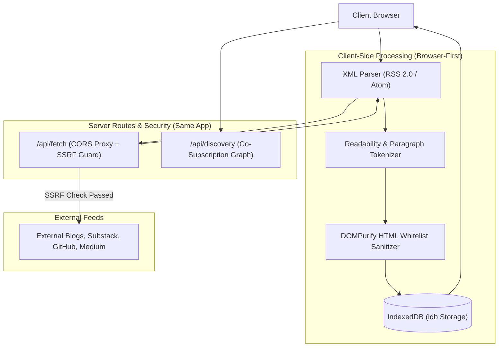

# IncogniRead — The Anonymous Editorial & Small Web Dispatch

IncogniRead is an offline-first, client-parsed broadsheet newspaper and RSS reader featuring:
- **Client-Side Engine**: In-browser XML parsing via `fast-xml-parser`, article readability extraction, and strict `DOMPurify` HTML sanitization.
- **Offline Storage**: Persistent IndexedDB cache for feeds, articles, and read states using `idb`.
- **Editorial Broadsheet Design**: Modeled after traditional broadsheets with classic editorial serif typography, dual-column reading, drop-caps, and real-world editorial photography.
- **Server Routes & SSRF Defense**: `/api/fetch` CORS relay protected against SSRF (blocking loopback, RFC1918, link-local, and cloud metadata IPs) + `/api/discovery` anonymous co-subscription graph using salted SHA-256 IP hashing.
- **Design Aesthetic**: Aged Broadsheet (`#F4F1EA`) and Midnight Press (`#0B0C0E`) high-contrast palettes with 3D tactile theme toggles.

---

## 🏛 System Architecture



---

## 🚀 Running IncogniRead

```powershell
# 1. Install dependencies
npm install

# 2. Launch Vite development server
npm run dev
```

The application runs on `http://localhost:3001`.
