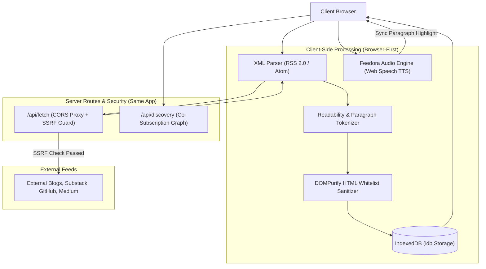

# Feedora — Privacy-First Offline-First RSS Reader with Interactive TTS Narration

Feedora is an offline-first, client-parsed RSS and Atom feed reader featuring:
- **Client-Side Engine**: In-browser XML parsing via `fast-xml-parser`, article readability extraction, and strict `DOMPurify` HTML sanitization.
- **Offline Storage**: Persistent IndexedDB cache for feeds, articles, read states, and audio playback positions using `idb`.
- **Feedora Audio (TTS)**: Interactive Web Speech narration engine with persistent floating audio player, ±10s skip, speed rates (0.75x–2.0x), and real-time synchronized paragraph highlighting in Reader View.
- **Server Routes & SSRF Defense**: `/api/fetch` CORS relay protected against SSRF (blocking loopback, RFC1918, link-local, and cloud metadata IPs) + `/api/discovery` anonymous co-subscription graph using salted SHA-256 IP hashing.
- **Design Aesthetic**: Dark glassmorphism (`bg-slate-950`, `bg-slate-900/60`, `backdrop-blur-xl`), Amber Gold `#F59E0B` active/RSS indicators, and Emerald Green `#10B981` audio playback/security badges.

---

## 🏛 System Architecture



---

## 🚀 Running Feedora

```powershell
# 1. Enter the project folder
cd "C:\Users\DELL\.gemini\antigravity\scratch\feedora-app"

# 2. Install dependencies
npm install

# 3. Launch Vite development server
npm run dev
```

The application runs on `http://localhost:3001`.
